
<picture>
  <source media="(prefers-color-scheme: dark)" srcset="game/branding/logo_wide_dark.png">
  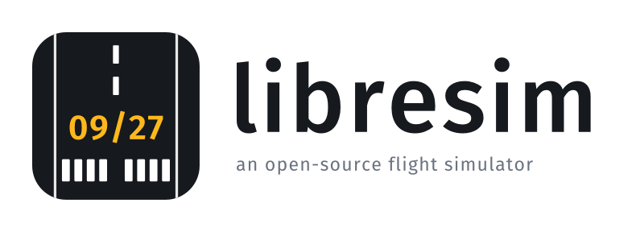
</picture>

# libresim

A free, offline flight simulator for the Mumbai–Pune region (with a corridor down to Kochi), built with Godot 4. Two aircraft: a realistic Cessna 172 and a simplified A320-family twin-jet.

- **Terrain:** Copernicus 30 m elevation, Sentinel-2 satellite imagery, ESA WorldCover land cover as procedural ground detail, runways and taxiways from OpenStreetMap.
- **Flight model:** a JSBSim-derived 6-DOF model, checked against the C172S POH by headless test cards. The A320 uses the FlightGear A320-family JSBSim data (converted to JSON) with a fly-by-wire control law written for libresim. It is not validated against real-aircraft data.
- **Cessna 172:** the FlightGear c172p 3D model and cockpit with live, physically modelled instruments. Your call sign is painted on the fuselage as the tail number (`--callsign=VT-LBR`, or set it in the options).
- **A320-family twin-jet:** fly-by-wire, FADEC turbofans, airliner systems (electrical, hydraulics, fuel, warnings), autopilot and glass cockpit displays (PFD, ND, engine and system pages). Fly it from a gate or a runway. The gate's jetway extends to the door. Wing and engine anti-ice work in icing. It is the newer, cruder aircraft: no FMGC flight plan or managed profile, a lite MCDU, no bleed or pack model, untuned turbojet recording as engine sound, a generic white livery, and some gates (right-side ones, very long jetways) do not dock. See [docs/A320-STATUS.md](docs/A320-STATUS.md).
- **Per-aircraft data:** an aircraft is a folder of JSON (`game/aircraft/<id>/`), not code. See "Adding an aircraft" in [docs/USAGE.md](docs/USAGE.md).
- **Simulation:** systems, failures, weather with ridge lift off the Western Ghats, time of day, night lighting.

**Quick start:** double-click **Start libresim** (Linux: `Start libresim.desktop`, macOS: `Start libresim.command`; see [docs/USAGE.md](docs/USAGE.md)). The first time, a window sets everything up; after that it starts the game. From a terminal, `./run.sh` checks and installs the prerequisites (asking before any `sudo`), downloads the data, builds it and opens the game. Running it again just launches the game. `./run.sh --help` lists the options.

## Screenshots

Real in-game captures, 1920x1080, Ultra preset, not edited. Regenerate them with [`tools/make_screenshots.sh`](tools/make_screenshots.sh).

<table>
  <tr>
    <td width="50%">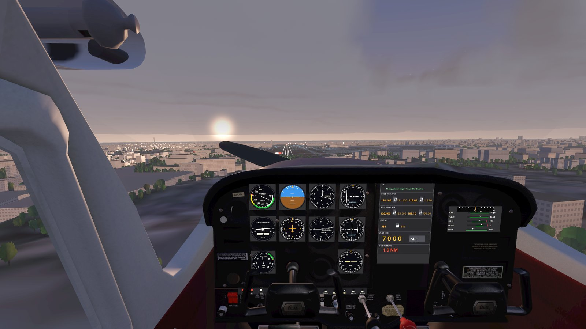 Cockpit view on final for Mumbai (VABB) runway 27, Cessna 172, sunset, broken cloud.</td>
    <td width="50%">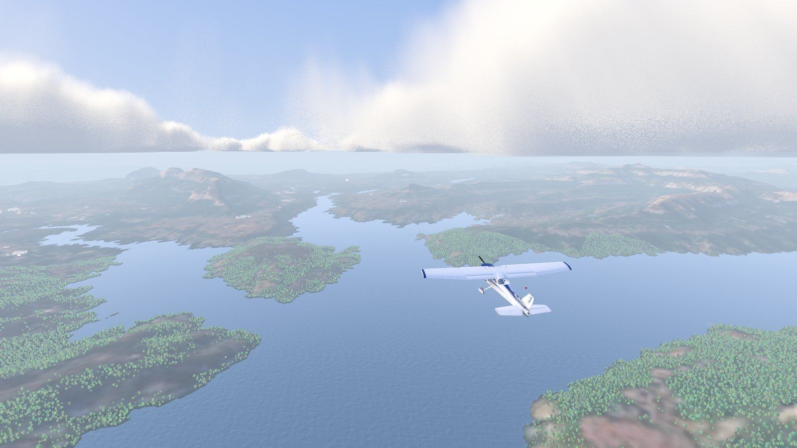 Chase view over the lakes and hills of the Western Ghats near Aamby Valley (VAAV), late afternoon, haze.</td>
  </tr>
  <tr>
    <td width="50%">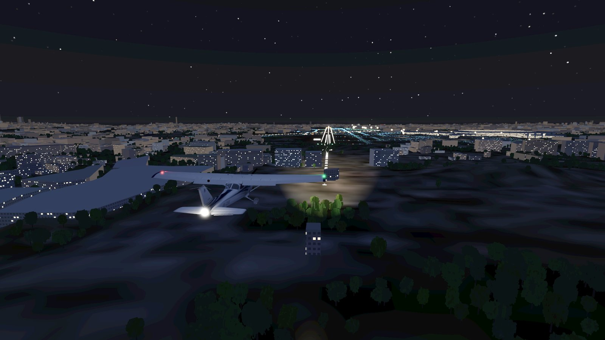 Night approach to Mumbai (VABB) runway 27: approach and runway lights, city lights, landing light.</td>
    <td width="50%">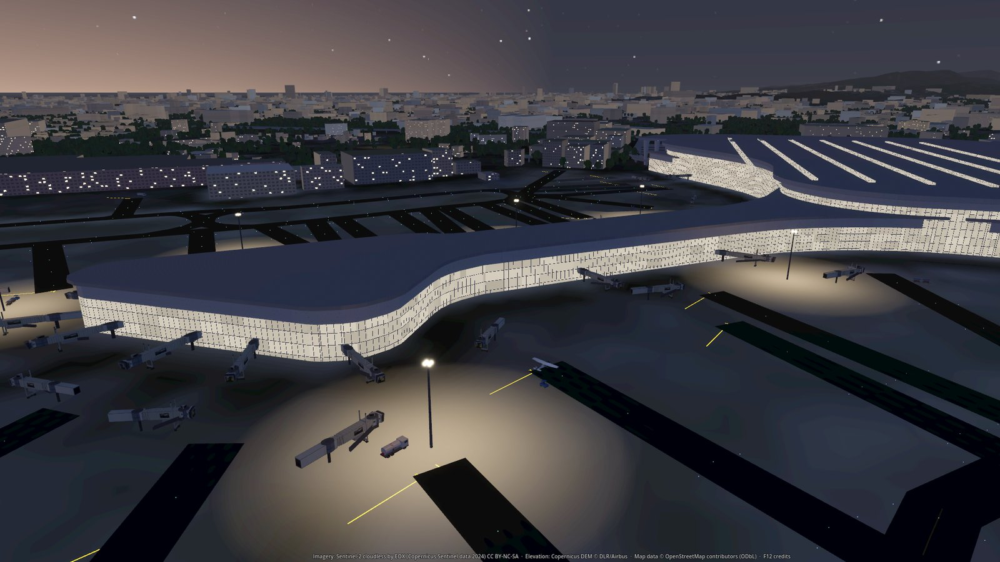 Mumbai (VABB) terminal and jetways at dusk, seen from above the apron.</td>
  </tr>
  <tr>
    <td width="50%">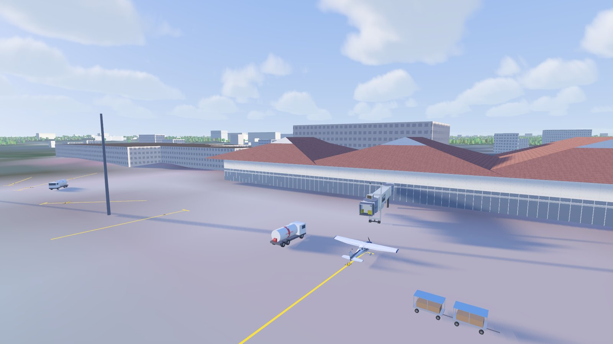 A gate at Kochi (VOCI) with the terminal, jetway, fuel truck and baggage carts, late afternoon.</td>
    <td width="50%">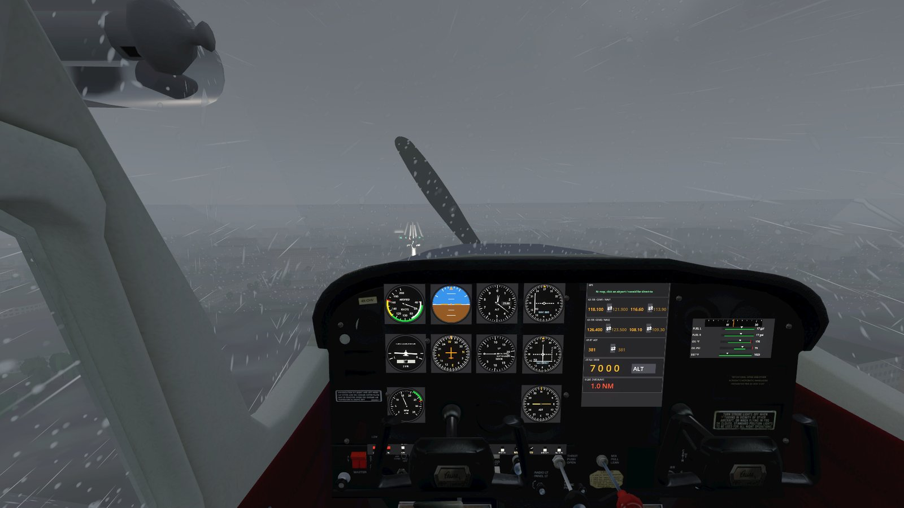 Monsoon approach to Mumbai (VABB) runway 27: heavy rain under a low cloud deck.</td>
  </tr>
  <tr>
    <td width="50%">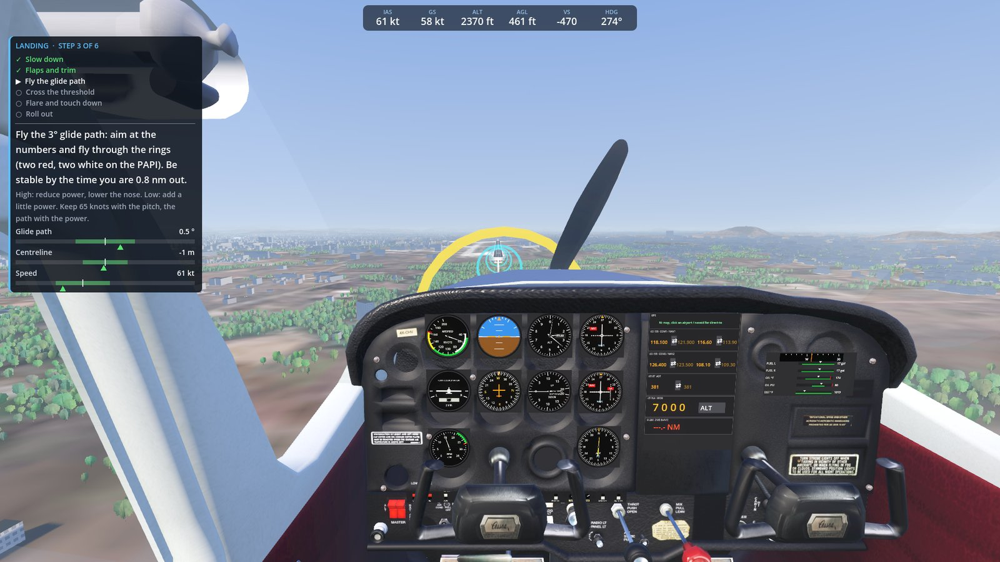 Training mode, Landing lesson: step card, live gauges and the glide-path ring.</td>
    <td width="50%">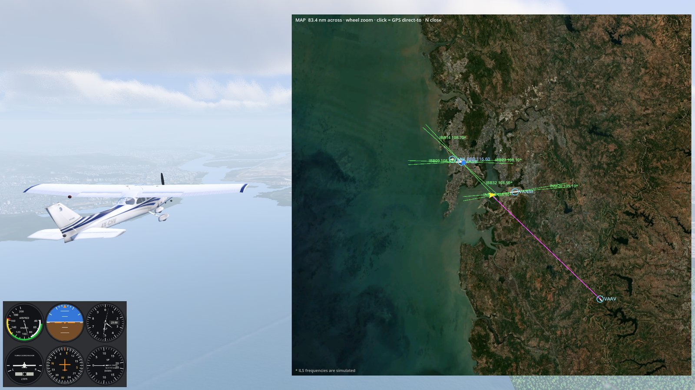 Moving map with a GPS direct-to line, over Mumbai and Navi Mumbai.</td>
  </tr>
  <tr>
    <td width="50%">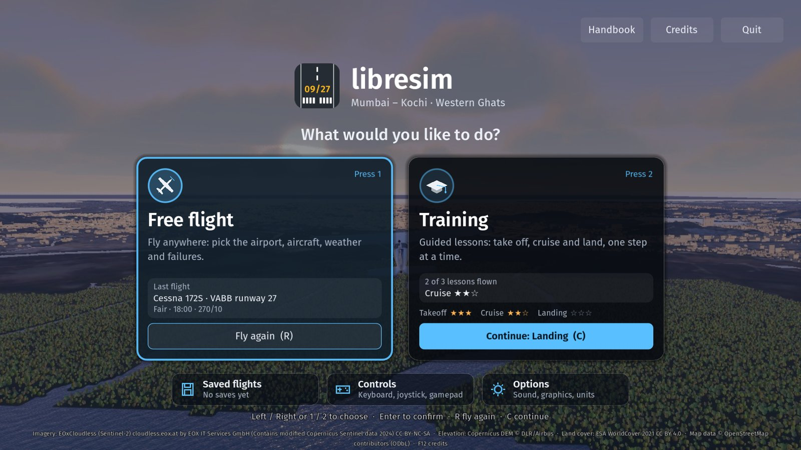 Start screen: Free flight or Training, with Fly again and Continue shortcuts and each lesson's stars.</td>
    <td width="50%">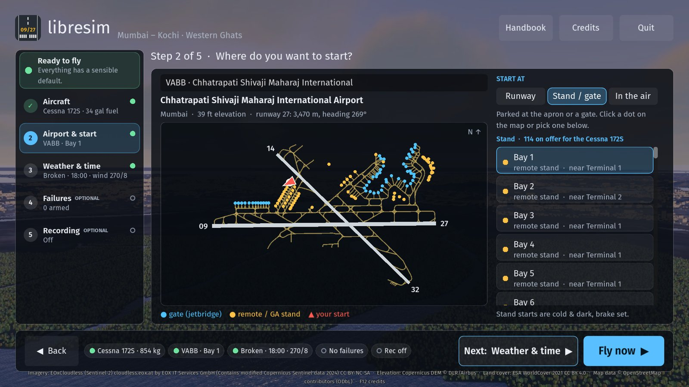 Free-flight setup: search for an airport, then click a runway end or a stand on its real taxiway map; the footer shows the whole setup and the one Fly button.</td>
  </tr>
  <tr>
    <td width="50%">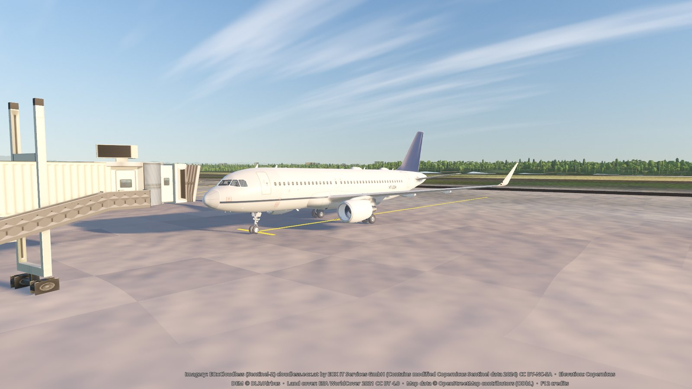 A320-family airliner at a gate at Kochi (VOCI), golden hour, seen from the nose.</td>
    <td width="50%">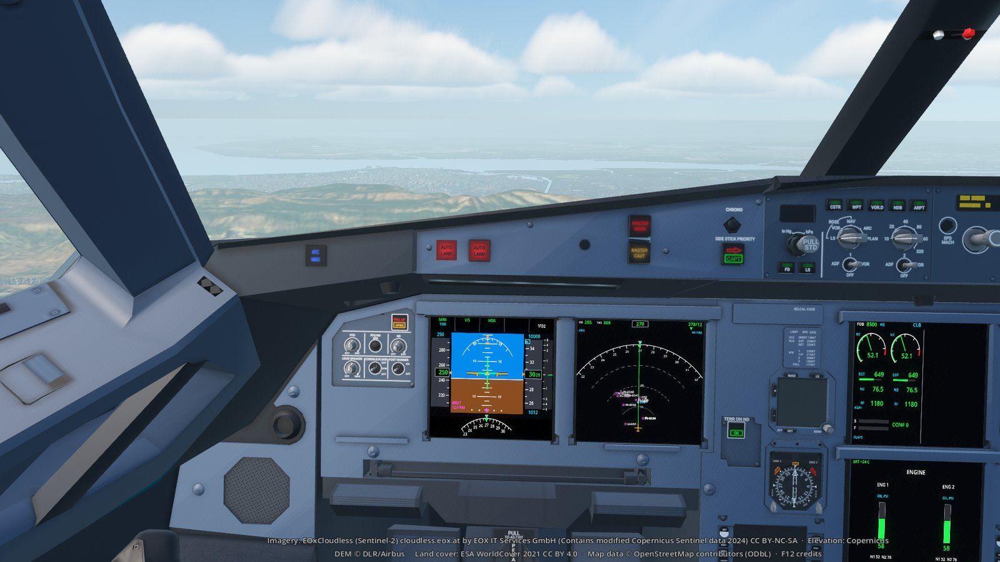 A320 cockpit at 3,000 ft near Mumbai: primary flight display, navigation display in arc mode, engine page.</td>
  </tr>
  <tr>
    <td width="50%">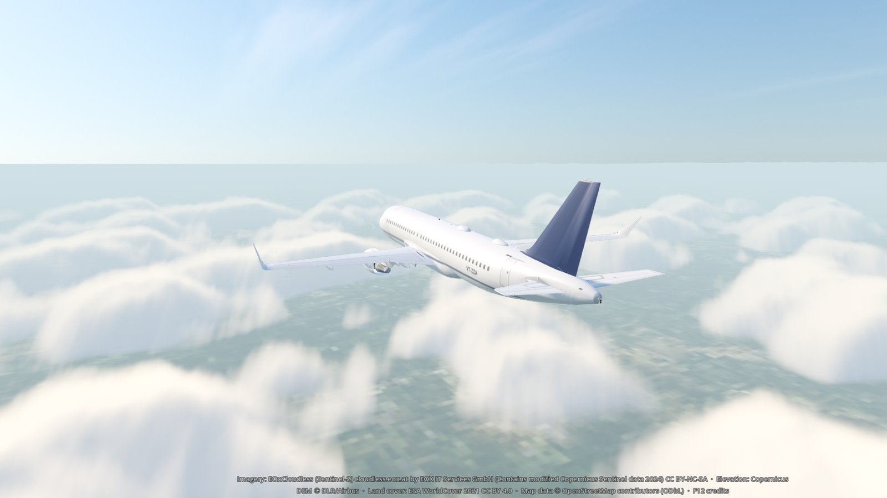 Chase view of the A320 above scattered cloud near Pune (VAPO), 9,000 ft, gear up.</td>
    <td width="50%">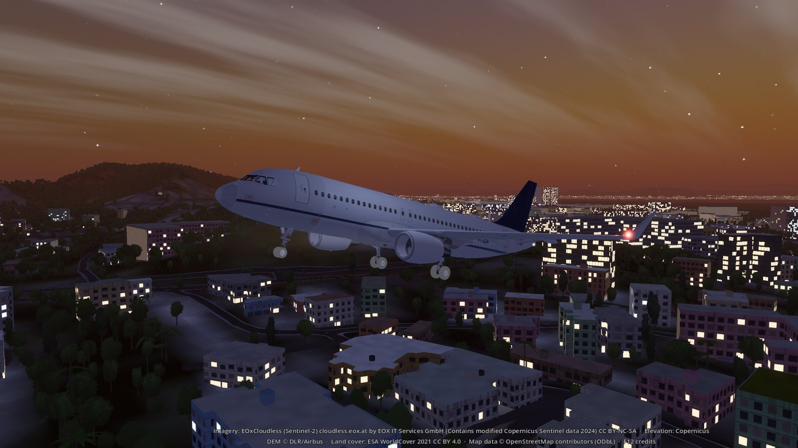 A320 on approach to Mumbai (VABB) runway 27 at dusk, gear down, over the lit suburbs.</td>
  </tr>
  <tr>
    <td width="50%">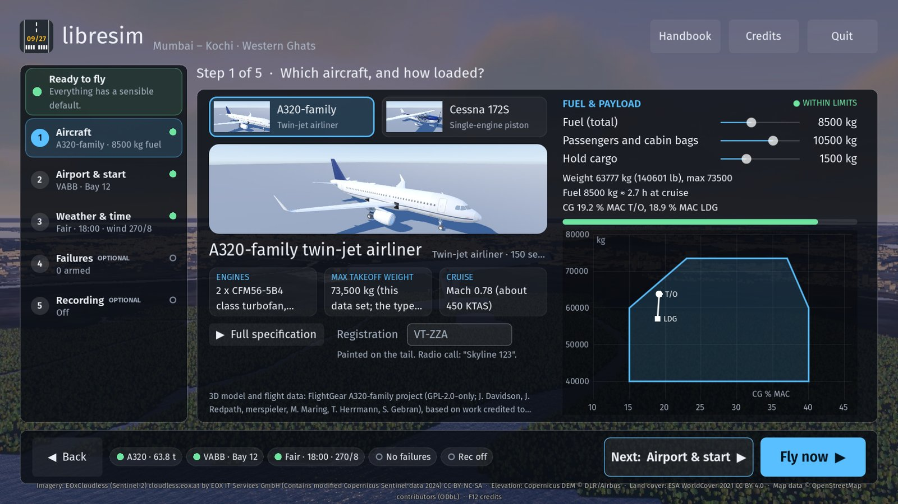 Start screen, aircraft step: A320 key figures, fuel and payload sliders, and the weight and balance envelope (approximate).</td>
    <td width="50%">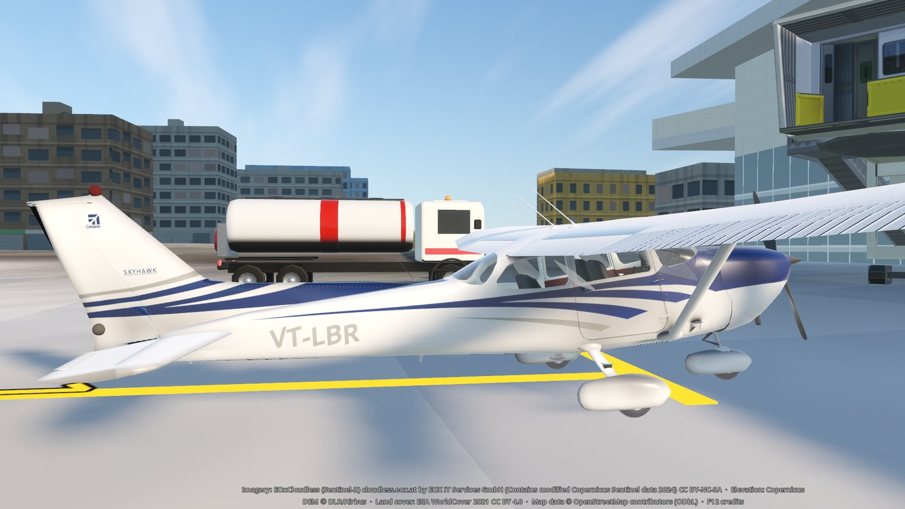 Cessna 172 at Pune (VAPO) wearing the call sign you choose as its tail number (VT-LBR here).</td>
  </tr>
</table>

The A320 shown in the screenshots is the FlightGear A320-family aircraft model by Josh Davidson, Jonathan Redpath, merspieler, Matthew Maring, Thorsten Herrmann, Semir Gebran and others, based on work credited to Immersive Design Group (GPL-2.0-only), recoloured and converted by libresim, with a generic livery; it is not affiliated with or endorsed by Airbus, an airline or an engine maker ("Airbus" and "A320" are Airbus trademarks, used factually). See [CREDITS.md](CREDITS.md) and [third_party/a320-family](third_party/a320-family/SOURCE.md).

Screenshots show Sentinel-2 cloudless imagery by EOX IT Services GmbH (contains modified Copernicus Sentinel data 2024), Copernicus GLO-30 DEM © DLR e.V. and Airbus Defence and Space GmbH, land cover from ESA WorldCover 2021 v200 © ESA WorldCover project (CC BY 4.0; contains modified Copernicus Sentinel data (2021) processed by ESA WorldCover consortium), and map data © OpenStreetMap contributors (ODbL); see [CREDITS.md](CREDITS.md). The imagery is licensed for non-commercial use only (CC BY-NC-SA 4.0), so the screenshots follow the same terms (see [docs/LICENSING.md](docs/LICENSING.md)).

## Relation to FlightGear and JSBSim

libresim is not a fork of FlightGear and has no FlightGear or JSBSim source code. It is a separate simulator in GDScript on Godot, with its own flight-dynamics integrator, engine, systems, instruments, radios, ATC and world streaming. It reuses FlightGear-project work as data and assets:
- the c172p 3D model, cockpit, textures and sounds (GPL-2.0-or-later, by the c172p team);
- four fgdata airport models (GPL-2.0);
- the A320-family 3D model, cockpit and JSBSim flight, engine and systems data (GPL-2.0-only, converted by libresim);
- JSBSim's c172p aerodynamic, mass and propeller data (LGPL-2.1), converted to JSON and retuned.

By file size most of the repository is those assets; by lines of code almost none of it is. See [docs/PROVENANCE.md](docs/PROVENANCE.md) for the audit and numbers.

**Docs:**
- How to install, build the data, run and fly: [docs/USAGE.md](docs/USAGE.md)
- Roadmap: [PLAN.md](PLAN.md)
- How libresim differs from FlightGear (fact-checked comparison): [docs/LIBRESIM-VS-FLIGHTGEAR.md](docs/LIBRESIM-VS-FLIGHTGEAR.md)
- Where the code and assets come from (audit): [docs/PROVENANCE.md](docs/PROVENANCE.md)
- Credits: [CREDITS.md](CREDITS.md)
- Licences: [docs/LICENSING.md](docs/LICENSING.md)

**Licence:** libresim's own code is GPL-2.0-or-later (see [LICENSE](LICENSE)). The bundled FlightGear data files are GPL-2.0 (some "or later"), and the bundled A320-family data is GPL-2.0-only (no "or later"), so a complete distribution that includes it is GPL-2.0 as a whole (libresim's own GPL-2.0-or-later code may be combined with it; see [docs/LICENSING.md](docs/LICENSING.md)). Other third-party assets keep their own licences, as listed in [CREDITS.md](CREDITS.md). The map imagery used in the screenshots is CC BY-NC-SA 4.0, so do not sell or ship the game with it in paid or ad-supported stores.
